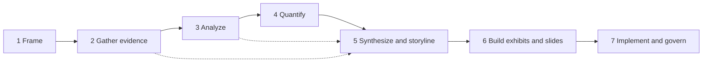

# Consultant Toolkit: 50 Portable Agent Skills

Fifty single-purpose skills that take a consulting engagement from a vague
request to an adopted change. Each skill owns exactly one output, so you can
combine any of them without duplicated work. The same files run on Claude and
OpenAI products.

## How the set stays MECE

- **One skill, one output.** The catalog below names the one output each skill
  owns. No two skills own the same output. The validator enforces this.
- **Seven phases, in engagement order.** Each phase answers one question. Inside
  a phase, skills split on a single rule (shown in each heading).
- **Explicit hand-offs.** Each skill lists what it is not for and which skill to
  use instead, so a request reaches one owner.
- **Additive outputs.** All skills use the same labels: `[Assumption]`,
  `[Estimate]`, `[Unverified]`, and inline sources. One skill's output is the
  next skill's input.
- **One owner for shared elements.** `insight-synthesis` owns the one-line
  answer. `chart-selection` owns chart encoding. `visual-consistency` owns
  deck-wide number and term rules. `recommendation-deck` decides what goes to
  the appendix. Other skills reuse these outputs; they do not redo them.



## Catalog

### 1. Frame: what must we solve, and for whom?

Split: question, audience, structure, test plan, and a structure audit.

| #   | Skill             | Owns (one output)                                                    |
| --- | ----------------- | -------------------------------------------------------------------- |
| 1   | `problem-framing` | Problem statement with the key question, scope, and success criteria |
| 2   | `audience-brief`  | Audience profile for one deliverable                                 |
| 3   | `issue-tree`      | Logic tree of sub-questions                                          |
| 4   | `hypothesis-map`  | Hypothesis-driven workplan                                           |
| 5   | `mece-check`      | Overlap and gap audit of an existing structure                       |

### 2. Gather evidence: what do the facts say?

Split: by source type. Rate sources first, then synthesize each type.

| #   | Skill                 | Owns (one output)                                      |
| --- | --------------------- | ------------------------------------------------------ |
| 6   | `source-validation`   | Source credibility log                                 |
| 7   | `research-synthesis`  | Findings from secondary (desk) sources                 |
| 8   | `interview-synthesis` | Themes from interviews, expert calls, and focus groups |
| 9   | `survey-analysis`     | Results from questionnaire data                        |

### 3. Analyze: where do we stand, and where could we go?

Split: outside-in (macro, industry, market, customers, competitors), then
inside-out (activities, capabilities), then choices.

| #   | Skill                   | Owns (one output)                                      |
| --- | ----------------------- | ------------------------------------------------------ |
| 10  | `pestel-scan`           | Ranked macro-trend table                               |
| 11  | `five-forces`           | Industry attractiveness assessment                     |
| 12  | `market-sizing`         | TAM, SAM, and SOM estimate                             |
| 13  | `customer-segmentation` | Customer segment definitions and targeting             |
| 14  | `competitor-benchmark`  | Client-versus-peer comparison table                    |
| 15  | `value-chain`           | Activity cost and value map                            |
| 16  | `vrio-analysis`         | Sustained-advantage test of resources and capabilities |
| 17  | `swot-analysis`         | Consolidated SWOT with strategic implications          |
| 18  | `growth-strategy`       | Prioritized growth avenue map                          |
| 19  | `strategic-options`     | Scored, mutually exclusive strategic alternatives      |
| 20  | `portfolio-matrix`      | Portfolio roles for existing units                     |
| 21  | `pricing-strategy`      | Price metric, structure, level, and discount rules     |

### 4. Quantify: what is it worth?

Split: by financial view. Per unit, projection, investment case, coherent
futures, and single-driver stress test.

| #   | Skill                  | Owns (one output)                           |
| --- | ---------------------- | ------------------------------------------- |
| 22  | `unit-economics`       | Per-unit profitability and payback          |
| 23  | `financial-model`      | Driver-based financial projection           |
| 24  | `business-case`        | Incremental investment case and funding ask |
| 25  | `scenario-analysis`    | Consistent multi-driver future scenarios    |
| 26  | `sensitivity-analysis` | Driver ranking and breakeven thresholds     |

### 5. Synthesize and storyline: what is the answer, and how do we argue it?

Split: meaning, opening, logic, data narrative, slide plan, and the two written
formats (summary of a deliverable versus a request for a decision).

| #   | Skill                 | Owns (one output)                                        |
| --- | --------------------- | -------------------------------------------------------- |
| 27  | `insight-synthesis`   | Ranked cross-workstream insights and the one-line answer |
| 28  | `scqa-storyline`      | Situation-complication-question-answer opening           |
| 29  | `pyramid-structure`   | Governing thought, key lines, and support                |
| 30  | `executive-summary`   | One-page summary of a finished deliverable               |
| 31  | `decision-memo`       | Stand-alone memo that requests one decision              |
| 32  | `recommendation-deck` | Ghost deck (slide-by-slide plan)                         |
| 33  | `data-storytelling`   | Narrative for one analysis                               |

### 6. Build exhibits and slides: how do we show it?

Split: chart type, then chart, then exhibit, then slide. Words, layout, and
style each have one owner. The last skill is the readiness gate.

| #   | Skill                | Owns (one output)                                       |
| --- | -------------------- | ------------------------------------------------------- |
| 34  | `chart-selection`    | Chart type choice for one message                       |
| 35  | `data-visualization` | Rendered chart or chart spec                            |
| 36  | `exhibit-builder`    | Slide-ready exhibit with callouts and sources           |
| 37  | `action-titles`      | Slide headlines                                         |
| 38  | `slide-layout`       | Layout of one slide                                     |
| 39  | `slide-copy-editor`  | Edited slide body text                                  |
| 40  | `visual-consistency` | Deck-wide style spec and deviation log                  |
| 41  | `appendix-builder`   | Appendix and cross-reference map                        |
| 42  | `speaker-notes`      | Presenter notes and timing                              |
| 43  | `deck-quality-check` | Readiness verdict, figure tie-out, and routed issue log |

### 7. Implement and govern: how does it happen and stick?

Split: when, how organized, who decides, who to engage, how people adopt, what
could go wrong, and how we measure.

| #   | Skill                    | Owns (one output)                               |
| --- | ------------------------ | ----------------------------------------------- |
| 44  | `implementation-roadmap` | Phased roadmap with milestones and dependencies |
| 45  | `operating-model`        | Target operating model and gaps                 |
| 46  | `raci-builder`           | RACI matrix                                     |
| 47  | `stakeholder-map`        | Stakeholder register and engagement plan        |
| 48  | `change-plan`            | People-side change plan and adoption metrics    |
| 49  | `risk-assessment`        | Delivery risk register                          |
| 50  | `kpi-dashboard`          | KPI tree, dictionary, and dashboard wireframe   |

## Example chains

- **Growth strategy:** `problem-framing` > `audience-brief` > `issue-tree` >
  `hypothesis-map` > `market-sizing` > `customer-segmentation` >
  `growth-strategy` > `strategic-options` > `business-case` >
  `insight-synthesis` > `scqa-storyline` > `pyramid-structure` >
  `recommendation-deck` > `action-titles` > `deck-quality-check`.
- **Cost diagnostic:** `problem-framing` > `issue-tree` > `value-chain` >
  `competitor-benchmark` > `financial-model` > `sensitivity-analysis` >
  `insight-synthesis` > `executive-summary`.
- **Board decision:** `audience-brief` > `strategic-options` > `business-case` >
  `decision-memo`.
- **Rollout:** `operating-model` > `implementation-roadmap` > `raci-builder` >
  `stakeholder-map` > `change-plan` > `risk-assessment` > `kpi-dashboard`.

## Install

Each skill is one folder with one `SKILL.md`. Install only the skills you need,
or all 50.

| Surface                    | How to install                                                                                                                                                                                           |
| -------------------------- | -------------------------------------------------------------------------------------------------------------------------------------------------------------------------------------------------------- |
| Claude Code                | Copy the folders to `~/.claude/skills/` (all projects) or `.claude/skills/` (one repository).                                                                                                            |
| Claude apps (web, desktop) | Zip each folder and upload it in Settings, under Skills.                                                                                                                                                 |
| Claude API                 | Upload each folder through the Skills API (`/v1/skills`). Attach skills to a request through the container `skills` list with the code execution tool.                                                   |
| Codex (CLI, IDE, app)      | Copy the folders to `.agents/skills/` in a repository, or `~/.agents/skills/` for all repositories. Older Codex builds read `~/.codex/skills/`. Mention a skill with `$skill-name`, or let Codex choose. |
| ChatGPT                    | Where your workspace has skills turned on, upload one zip per skill.                                                                                                                                     |
| OpenAI API                 | Upload each folder through the Skills API (`/v1/skills`). Attach skills to the hosted shell container.                                                                                                   |
| GitHub Copilot             | Copy the folders to `.github/skills/` in a repository.                                                                                                                                                   |
| Any other model            | Paste the body of a `SKILL.md` into the system or developer instructions.                                                                                                                                |

Make one zip per skill, with the folder at the zip root:

```sh
cd consultant-toolkit/skills
mkdir -p ../dist
for d in */; do zip -qr "../dist/${d%/}.zip" "$d"; done
```

On Windows PowerShell:

```powershell
cd consultant-toolkit\skills
New-Item -ItemType Directory -Force ..\dist | Out-Null
Get-ChildItem -Directory | ForEach-Object { Compress-Archive -Path $_.Name -DestinationPath "..\dist\$($_.Name).zip" -Force }
```

References: [Agent Skills specification](https://agentskills.io/specification),
[Claude Agent Skills](https://platform.claude.com/docs/en/agents-and-tools/agent-skills/overview),
[Claude Skills API guide](https://platform.claude.com/docs/en/build-with-claude/skills-guide),
[Codex skills](https://developers.openai.com/codex/skills),
[OpenAI API skills](https://developers.openai.com/api/docs/guides/tools-skills).

## Portability rules

Run `npm run consultant-toolkit:check` after any edit. It enforces:

| Rule                                                                                                                                     | Why                                                                                       |
| ---------------------------------------------------------------------------------------------------------------------------------------- | ----------------------------------------------------------------------------------------- |
| Frontmatter has only `name` and a double-quoted `description`                                                                            | These are the two fields every surface reads.                                             |
| `name` matches the folder: lowercase words joined by single hyphens, with no vendor words                                                | Open-standard naming rule. Claude rejects reserved words.                                 |
| Description of 160 bytes or less, ASCII, no angle brackets, ending with a "Use ..." trigger                                              | Under the strictest per-field limits. Claude rejects XML tags. The trigger helps routing. |
| All names and descriptions total 8,000 bytes or less                                                                                     | Fits the Codex skill-list budget, so no skill is shortened or dropped.                    |
| Each `SKILL.md` is 4 KB or less                                                                                                          | Loads in full on every surface.                                                           |
| No vendor product names, host tool names, or host syntax in the body. Open formats (Vega-Lite, Mermaid) appear only as optional outputs. | The same instructions work in every product.                                              |
| Same sections and shared rules in every skill                                                                                            | Outputs chain cleanly from one skill to the next.                                         |
| Every skill reference resolves to a real skill, and each catalog output is unique                                                        | Hand-offs work, and no two skills overlap.                                                |

Skills that can use code (for example `data-visualization` and
`financial-model`) say what to do when code execution is available and when it
is not. No skill needs scripts, network access, or a specific tool.

## Out of scope

These are deliberate gaps, not overlaps:

- Selling and scoping work: proposals and statements of work.
- Collecting evidence: survey and interview-guide design, data collection, and
  workshop facilitation.
- Detailed operations work: process mapping, and sizing cost-saving levers.
- Programme reporting: status reports and RAID logs (risks, actions, issues,
  decisions).
- Specialist advice: legal, tax, and M&A due diligence.

## Attribution

This is an independent toolkit. It is not affiliated with or endorsed by any
consulting firm. Framework names belong to their authors: Porter (Five Forces,
value chain), Barney (VRIO), Minto (Pyramid Principle), BCG (growth-share
matrix), GE and McKinsey (nine-box matrix), Ansoff (growth matrix), and Prosci
(ADKAR).
