# Delivery Lineage: consulting-firm-gtm

> Customer-safe graph. EAI dependencies stop at published PublicAPI capabilities.

```mermaid
flowchart LR
  subgraph stage_intent["Intent"]
    direction TB
    n0["Consulting firms of 1 to 250 people need credible AI advice, ROI proof and client apps<br/>Customer Need"]:::current
    n1["Customer and problem<br/>Documentation File"]:::current
    n2["Research evidence<br/>Documentation File"]:::current
    n49["EAI Product<br/>Owner"]:::current
  end
  subgraph stage_requirements["Requirements"]
    direction TB
    n3["50 business scenarios<br/>Documentation File"]:::current
    n4["Specification<br/>Documentation File"]:::current
    n5["FR-01 to FR-04 Attract and install<br/>Requirement"]:::current
    n6["FR-05 to FR-13 Consulting methods<br/>Requirement"]:::current
    n7["FR-14 to FR-18 Advice to app<br/>Requirement"]:::current
    n8["FR-19 to FR-24 Account and workspace<br/>Requirement"]:::current
    n9["FR-25 to FR-28 Learn and certify<br/>Requirement"]:::current
    n10["FR-29 to FR-33 Deploy, run and prove ROI<br/>Requirement"]:::current
    n11["FR-34 to FR-37 Share and grow<br/>Requirement"]:::current
    n12["FR-38 to FR-44 Firm, enterprise and measurement<br/>Requirement"]:::current
    n13["EPR-1 to EPR-10 EAI Platform requests at the PublicAPI boundary<br/>Requirement"]:::current
  end
  subgraph stage_architecture["Architecture"]
    direction TB
    n14["End-to-end design<br/>Documentation File"]:::current
    n15["Gofer plugin, landing page, connector and EAI Platform path<br/>Architecture"]:::current
    n16["Firm parent workspace with one child workspace per client<br/>Architecture"]:::current
    n17["Decisions<br/>Documentation File"]:::current
    n18["D1 Proposed: Free plugin, paid when apps run<br/>Decision"]:::current
    n19["D1 Not recommended: paid plugin subscription<br/>Decision"]:::current
    n20["D2 Proposed: One public command with playbooks on demand<br/>Decision"]:::current
    n21["D2 Not recommended: a separate public skill for each playbook<br/>Decision"]:::current
    n22["D2 Not recommended: depend on skills over MCP now<br/>Decision"]:::current
    n23["D3 Proposed: Direct install link, person posts<br/>Decision"]:::current
    n24["D3 Not recommended: comment Go to receive it<br/>Decision"]:::current
    n25["D3 Not recommended: automatic posting<br/>Decision"]:::current
    n26["D4 Proposed: Landing page referral code first<br/>Decision"]:::current
    n27["D4 Not recommended: build the connector before launch<br/>Decision"]:::current
    n28["D5 Proposed: Guide to the website sign-up now<br/>Decision"]:::current
    n29["D5 Not recommended: a Gofer sign-up command now<br/>Decision"]:::current
    n30["D6 Proposed: Firm parent workspace with one child per client<br/>Decision"]:::current
    n31["D6 Not recommended: one shared workspace for all clients<br/>Decision"]:::current
    n32["D6 Not recommended: a separate account for each client<br/>Decision"]:::current
    n33["D7 Proposed: Build in the Code tab of Claude Desktop<br/>Decision"]:::current
    n34["D7 Not recommended: terminal-only build path<br/>Decision"]:::current
    n35["D8 Proposed: Enterprise Managed Auth in a later phase<br/>Decision"]:::current
    n36["D8 Not recommended: EMA in the MVP<br/>Decision"]:::current
    n37["D9 Proposed: Stop at the PublicAPI boundary<br/>Decision"]:::current
    n38["PublicAPI account sign-up<br/>Public Api Capability"]:::suspect
    n39["PublicAPI workspace management<br/>Public Api Capability"]:::suspect
    n40["PublicAPI app deploy<br/>Public Api Capability"]:::suspect
  end
  subgraph stage_delivery["Delivery"]
    direction TB
    n41["Delivery plan<br/>Documentation File"]:::current
    n42["D10 Proposed: An MVP that needs no new platform work<br/>Decision"]:::current
    n43["D10 Not recommended: wait for the platform requests before launch<br/>Decision"]:::current
    n44["Phase 0 Validate and approve<br/>Work Order"]:::current
    n45["Phase 1 MVP: install, win, share, deploy (W1 to W7)<br/>Work Order"]:::current
    n46["Phase 2 Connector, learning and ROI proof (W8 to W13)<br/>Work Order"]:::current
    n47["Phase 3 Enterprise and partner scale (W14 to W19)<br/>Work Order"]:::current
  end
  subgraph stage_validation["Validation"]
    direction TB
    n48["Traceability<br/>Documentation File"]:::current
  end
  n17 -->|"Records Decision"| n18
  n17 -->|"Records Decision"| n19
  n17 -->|"Records Decision"| n20
  n17 -->|"Records Decision"| n21
  n17 -->|"Records Decision"| n22
  n17 -->|"Records Decision"| n23
  n17 -->|"Records Decision"| n24
  n17 -->|"Records Decision"| n25
  n17 -->|"Records Decision"| n26
  n17 -->|"Records Decision"| n27
  n17 -->|"Records Decision"| n28
  n17 -->|"Records Decision"| n29
  n17 -->|"Records Decision"| n30
  n17 -->|"Records Decision"| n31
  n17 -->|"Records Decision"| n32
  n17 -->|"Records Decision"| n33
  n17 -->|"Records Decision"| n34
  n17 -->|"Records Decision"| n35
  n17 -->|"Records Decision"| n36
  n17 -->|"Records Decision"| n37
  n17 -->|"Records Decision"| n42
  n17 -->|"Records Decision"| n43
  n1 -->|"Supports"| n0
  n0 -->|"Informs"| n3
  n3 -->|"Supports"| n5
  n5 -->|"Informs"| n15
  n3 -->|"Supports"| n6
  n6 -->|"Informs"| n15
  n3 -->|"Supports"| n7
  n7 -->|"Informs"| n15
  n3 -->|"Supports"| n8
  n8 -->|"Informs"| n15
  n3 -->|"Supports"| n9
  n9 -->|"Informs"| n15
  n3 -->|"Supports"| n10
  n10 -->|"Informs"| n15
  n3 -->|"Supports"| n11
  n11 -->|"Informs"| n15
  n3 -->|"Supports"| n12
  n12 -->|"Informs"| n15
  n3 -->|"Supports"| n13
  n13 -->|"Informs"| n15
  n8 -->|"Informs"| n16
  n2 -->|"Informs"| n4
  n2 -->|"Informs"| n20
  n2 -->|"Informs"| n28
  n2 -->|"Informs"| n35
  n18 -->|"Constrains"| n15
  n20 -->|"Constrains"| n15
  n23 -->|"Constrains"| n15
  n26 -->|"Constrains"| n15
  n28 -->|"Constrains"| n15
  n33 -->|"Constrains"| n15
  n35 -->|"Constrains"| n15
  n37 -->|"Constrains"| n15
  n30 -->|"Constrains"| n16
  n14 -->|"Supports"| n15
  n14 -->|"Supports"| n16
  n15 -->|"Depends On"| n38
  n16 -->|"Depends On"| n39
  n15 -->|"Depends On"| n40
  n13 -->|"Constrains"| n38
  n42 -->|"Constrains"| n45
  n41 -->|"Supports"| n45
  n45 -->|"Depends On"| n44
  n46 -->|"Depends On"| n45
  n47 -->|"Depends On"| n46
  n45 -->|"Implements"| n5
  n45 -->|"Implements"| n6
  n45 -->|"Implements"| n7
  n45 -->|"Implements"| n8
  n45 -->|"Implements"| n10
  n45 -->|"Implements"| n11
  n46 -->|"Implements"| n9
  n46 -->|"Implements"| n12
  n46 -->|"Implements"| n13
  n47 -->|"Implements"| n12
  n48 -->|"Supports"| n4
  n4 -->|"Owned By"| n49
  n41 -->|"Owned By"| n49
  linkStyle 0 stroke:#1565c0,stroke-width:2px
  linkStyle 1 stroke:#1565c0,stroke-width:2px
  linkStyle 2 stroke:#1565c0,stroke-width:2px
  linkStyle 3 stroke:#1565c0,stroke-width:2px
  linkStyle 4 stroke:#1565c0,stroke-width:2px
  linkStyle 5 stroke:#1565c0,stroke-width:2px
  linkStyle 6 stroke:#1565c0,stroke-width:2px
  linkStyle 7 stroke:#1565c0,stroke-width:2px
  linkStyle 8 stroke:#1565c0,stroke-width:2px
  linkStyle 9 stroke:#1565c0,stroke-width:2px
  linkStyle 10 stroke:#1565c0,stroke-width:2px
  linkStyle 11 stroke:#1565c0,stroke-width:2px
  linkStyle 12 stroke:#1565c0,stroke-width:2px
  linkStyle 13 stroke:#1565c0,stroke-width:2px
  linkStyle 14 stroke:#1565c0,stroke-width:2px
  linkStyle 15 stroke:#1565c0,stroke-width:2px
  linkStyle 16 stroke:#1565c0,stroke-width:2px
  linkStyle 17 stroke:#1565c0,stroke-width:2px
  linkStyle 18 stroke:#1565c0,stroke-width:2px
  linkStyle 19 stroke:#1565c0,stroke-width:2px
  linkStyle 20 stroke:#1565c0,stroke-width:2px
  linkStyle 21 stroke:#1565c0,stroke-width:2px
  linkStyle 22 stroke:#1565c0,stroke-width:2px
  linkStyle 23 stroke:#1565c0,stroke-width:2px
  linkStyle 24 stroke:#1565c0,stroke-width:2px
  linkStyle 25 stroke:#1565c0,stroke-width:2px
  linkStyle 26 stroke:#1565c0,stroke-width:2px
  linkStyle 27 stroke:#1565c0,stroke-width:2px
  linkStyle 28 stroke:#1565c0,stroke-width:2px
  linkStyle 29 stroke:#1565c0,stroke-width:2px
  linkStyle 30 stroke:#1565c0,stroke-width:2px
  linkStyle 31 stroke:#1565c0,stroke-width:2px
  linkStyle 32 stroke:#1565c0,stroke-width:2px
  linkStyle 33 stroke:#1565c0,stroke-width:2px
  linkStyle 34 stroke:#1565c0,stroke-width:2px
  linkStyle 35 stroke:#1565c0,stroke-width:2px
  linkStyle 36 stroke:#1565c0,stroke-width:2px
  linkStyle 37 stroke:#1565c0,stroke-width:2px
  linkStyle 38 stroke:#1565c0,stroke-width:2px
  linkStyle 39 stroke:#1565c0,stroke-width:2px
  linkStyle 40 stroke:#1565c0,stroke-width:2px
  linkStyle 41 stroke:#1565c0,stroke-width:2px
  linkStyle 42 stroke:#1565c0,stroke-width:2px
  linkStyle 43 stroke:#1565c0,stroke-width:2px
  linkStyle 44 stroke:#1565c0,stroke-width:2px
  linkStyle 45 stroke:#1565c0,stroke-width:2px
  linkStyle 46 stroke:#1565c0,stroke-width:2px
  linkStyle 47 stroke:#1565c0,stroke-width:2px
  linkStyle 48 stroke:#1565c0,stroke-width:2px
  linkStyle 49 stroke:#1565c0,stroke-width:2px
  linkStyle 50 stroke:#1565c0,stroke-width:2px
  linkStyle 51 stroke:#1565c0,stroke-width:2px
  linkStyle 52 stroke:#1565c0,stroke-width:2px
  linkStyle 53 stroke:#1565c0,stroke-width:2px
  linkStyle 54 stroke:#1565c0,stroke-width:2px
  linkStyle 55 stroke:#1565c0,stroke-width:2px
  linkStyle 56 stroke:#1565c0,stroke-width:2px
  linkStyle 57 stroke:#1565c0,stroke-width:2px
  linkStyle 58 stroke:#1565c0,stroke-width:2px
  linkStyle 59 stroke:#1565c0,stroke-width:2px
  linkStyle 60 stroke:#1565c0,stroke-width:2px
  linkStyle 61 stroke:#1565c0,stroke-width:2px
  linkStyle 62 stroke:#1565c0,stroke-width:2px
  linkStyle 63 stroke:#1565c0,stroke-width:2px
  linkStyle 64 stroke:#1565c0,stroke-width:2px
  linkStyle 65 stroke:#1565c0,stroke-width:2px
  linkStyle 66 stroke:#1565c0,stroke-width:2px
  linkStyle 67 stroke:#1565c0,stroke-width:2px
  linkStyle 68 stroke:#1565c0,stroke-width:2px
  linkStyle 69 stroke:#1565c0,stroke-width:2px
  linkStyle 70 stroke:#1565c0,stroke-width:2px
  linkStyle 71 stroke:#1565c0,stroke-width:2px
  linkStyle 72 stroke:#1565c0,stroke-width:2px
  linkStyle 73 stroke:#1565c0,stroke-width:2px
  linkStyle 74 stroke:#1565c0,stroke-width:2px
  linkStyle 75 stroke:#1565c0,stroke-width:2px
  linkStyle 76 stroke:#1565c0,stroke-width:2px
  linkStyle 77 stroke:#1565c0,stroke-width:2px
  linkStyle 78 stroke:#1565c0,stroke-width:2px
  linkStyle 79 stroke:#1565c0,stroke-width:2px
  classDef current fill:#e8f5e9,stroke:#2e7d32,color:#102a13
  classDef suspect fill:#fff4ce,stroke:#f59e0b,color:#3d2800
  classDef anchor_lost fill:#ffebee,stroke:#e53935,color:#3f1010
  classDef broken fill:#ffcdd2,stroke:#c62828,color:#3f1010
  classDef superseded fill:#eceff1,stroke:#8b949e,color:#30363d
  classDef final_selected fill:#e3f2fd,stroke:#1565c0,stroke-width:4px,color:#0d2440
  classDef rejected_decision fill:#eceff1,stroke:#8b949e,stroke-dasharray:5 4,color:#30363d
```

Generated from `delivery-lineage.json`. Open **Gofer: Show Delivery Lineage** for the interactive viewer.
