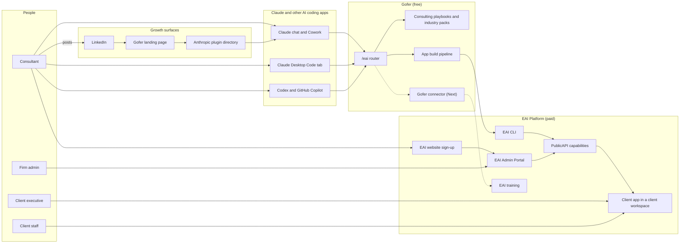
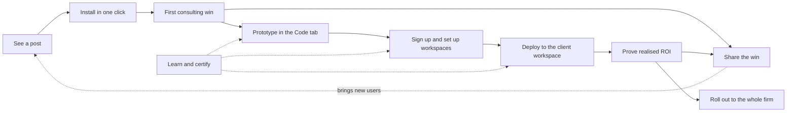
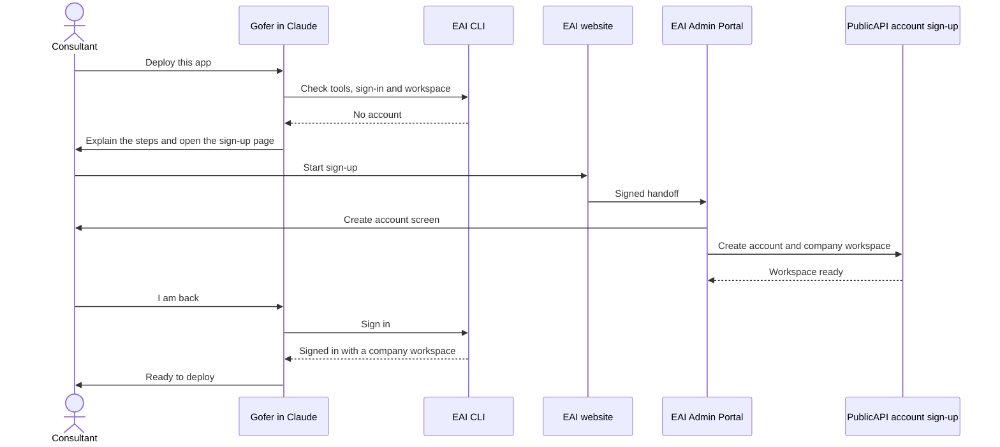
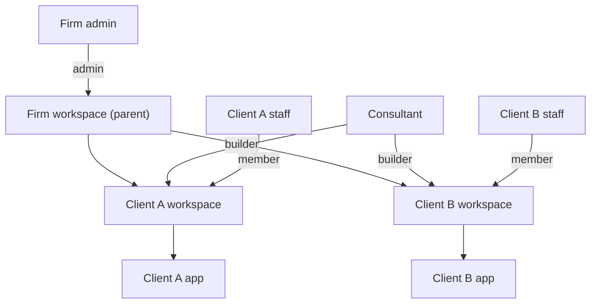
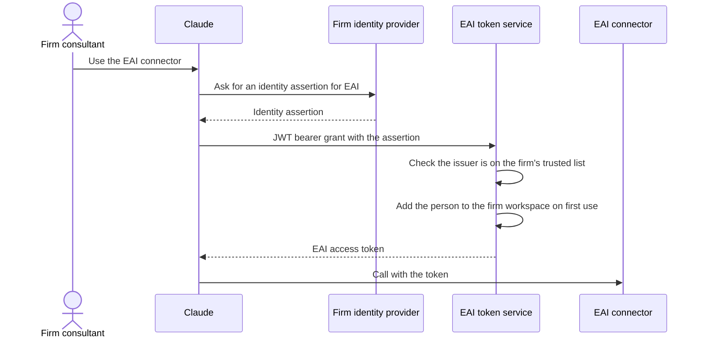

# Consulting Firm GTM - End-To-End Design

This design shows how a consulting firm moves from a LinkedIn post to a client
app that runs on EAI with proven ROI. It meets the [specification](spec.md) and
the [50 business scenarios](business-scenarios.md). The
[decisions](decisions.md) explain each proposed choice.

## System Context

- Gofer runs inside the person's AI coding app. Client content stays in that
  session and in the client's EAI workspace.
- The EAI Platform is reached only through the EAI website, the EAI Admin
  Portal, the EAI CLI and PublicAPI capabilities.
- Dotted lines are Next or Later parts.

## End-To-End Journey

| Step                       | Groups | Free or paid    | Main number      |
| -------------------------- | ------ | --------------- | ---------------- |
| See a post, install        | A      | Free            | Installs         |
| First consulting win       | B      | Free            | First wins       |
| Share the win              | G      | Free            | Shares           |
| Prototype                  | C      | Free            | Apps built       |
| Sign up, deploy, prove ROI | D, F   | Paid on EAI     | Apps live        |
| Learn and certify          | E      | Free, then paid | Levels completed |
| Firm rollout               | H      | Paid on EAI     | Firms active     |

## Gofer Plugin

### Proposed Approach: One Public Command With Playbooks On Demand

`/eai` stays the only public command. Claude reads one short description at
start. It opens a consulting playbook only when the request needs it. The
playbooks stay out of the slash menu.

- This keeps the menu short and the context cost low (NFR-04).
- The same plugin works in Claude chat, Cowork, the Code tab, Codex and GitHub
  Copilot (NFR-06).

### Reuse Of Existing Playbooks

Most requirements reuse the 66 consulting playbooks in PR #441.

| Requirement                  | Existing playbooks                                                                 | New work                                           |
| ---------------------------- | ---------------------------------------------------------------------------------- | -------------------------------------------------- |
| FR-08 AI opportunity scan    | `ai-opportunity-scan`, `ai-readiness-assessment`, `process-mapping`, `value-chain` | Industry packs feed it (FR-07)                     |
| FR-09 ROI model              | `business-case`, `financial-model`, `sensitivity-analysis`, `unit-economics`       | ROI one-page summary for a non-technical executive |
| FR-10 Plain-language outputs | `executive-summary`, `audience-brief`                                              | Glossary step                                      |
| FR-11 Firm branding          | Gofer branding helper                                                              | None                                               |
| FR-12 Quality check          | `mece-check`, `source-validation`, `deck-quality-check`                            | None                                               |
| FR-14 Advice to build        | `ai-bootcamp-design`, `ai-workflow-redesign`, Gofer business scenario stage        | ROI baseline carried into the spec                 |
| FR-31 Realised ROI report    | `ai-value-tracker`, `ai-value-capture-plan`, `pilot-to-scale-review`               | The app records the ROI measures                   |
| FR-18 Demo pack              | `process-mapping`, `speaker-notes`                                                 | Screenshot step from the preview check             |
| FR-33 Adoption material      | `change-plan`, Gofer stakeholder communications                                    | None                                               |
| FR-07 Industry packs         | None                                                                               | New pack files, one per industry                   |
| FR-34, FR-37 Share post      | None                                                                               | New `share-post` playbook with the post check      |
| FR-15 Code tab guide         | None                                                                               | New guide with screenshots                         |

### Industry Packs

Each pack is one Markdown file under the consulting references. It has:

- industry terms and plain definitions;
- typical processes and where time is lost;
- key measures for a baseline;
- benchmarks, each with a source and a date, or marked unverified;
- common AI opportunities, each with data needs and risks.

The MVP packs are local government, retail, healthcare, finance, manufacturing
and general. The general pack asks five questions to build context for any other
industry (BS-15). A firm can add its own pack later (FR-42).

### Share Post And Post Check

1. Gofer detects a first win: a finished deliverable or a running prototype.
2. Claude offers to draft a post. The person can say no.
3. The draft describes the outcome, the method and the industry. It has the
   person's referral link.
4. The post check removes client names, client figures, confidential details and
   other firms' brands (FR-37).
5. The person edits the draft and posts it. Gofer never posts.

## Landing Page And Referral Code

### Proposed Approach: Landing Page Referral Code In The MVP

The MVP uses a static landing page. The share link adds a short referral code.
The page counts visits per code. The page links to the Anthropic directory
listing. The directory usage report counts installs. The Next release links
codes to installs through the Gofer connector.

The landing page shows:

- what Gofer does, in three sentences;
- which Claude plan each step needs, checked at publish time;
- install steps for Claude, Codex and GitHub Copilot;
- the data-handling summary (FR-43).

## Gofer Connector (Next)

The connector is an MCP server that EAI runs. It adds the parts that a local
plugin cannot do.

| Tool                                  | Purpose                                                     | Requirement  |
| ------------------------------------- | ----------------------------------------------------------- | ------------ |
| `methods_list`, `method_get`          | Serve the method catalogue to Claude chat and Cowork users. | FR-06        |
| `event_record`                        | Record a count: method used, first win, post drafted.       | FR-44        |
| `share_link_create`, `referral_stats` | Make a referral link and show referral counts.              | FR-02, FR-35 |
| `training_list`, `training_get`       | Find the matching EAI training item.                        | FR-25        |

- **Data rule.** Events carry a method name, a count and an opaque install code.
  They carry no client content and no personal data (NFR-01).
- **Sign-in.** Anonymous install codes first. EAI sign-in through MCP
  authorisation when EPR-4 is ready. EMA later (FR-39).
- **Offline.** The playbooks also ship in the plugin. They work when the
  connector is down (NFR-08).
- **Skills over MCP.** The connector can add the MCP skills format when Claude
  supports it. No part of the MVP depends on it.

## Account And Workspace

### Sign-Up Now

- Gofer does not create accounts. It guides the person through the EAI website
  (FR-20).
- Gofer checks the result with the EAI CLI before it continues (FR-19).
- If the person stops halfway, the platform returns the same workspace on retry
  (BS-30).

### Sign-Up Later

- **EPR-1.** The website returns the person to the same Gofer session.
- **EPR-3.** The new workspace approves the EAI CLI, so the first deploy works
  with no support request.
- A direct `eai signup` command needs a separate product decision. See
  [decisions](decisions.md).

### Firm And Client Workspaces

- One parent workspace per firm. One child workspace per client (FR-22).
- The MVP creates client workspaces with the existing EAI CLI child-workspace
  capability. EPR-10 later adds creation from the EAI Admin Portal and builder
  roles for other consultants.
- Consultants build in each client workspace. Client staff are members of their
  own workspace only (FR-23, NFR-02).
- Gofer names the target workspace and waits for confirmation before each deploy
  (BS-31).
- At handover, the client gets an administrator in its own workspace. The firm
  keeps the access that the support agreement allows (FR-32).
- Gofer checks the exact EAI CLI commands with `eai --describe` and `--help`
  before it runs them (NFR-07).

## Deploy, Run And ROI

1. The app specification carries the ROI baseline and target from the ROI case
   (FR-14).
2. The app template records named ROI measures, for example cycle time, volume
   handled or error count (FR-31).
3. Gofer deploys with the EAI CLI and confirms the app is live (FR-29).
4. After an agreed period, Gofer reads the measures and writes the realised ROI
   report (BS-38).

The MVP records measures as app data in the client workspace. EPR-8 later gives
a standard PublicAPI capability for ROI measures.

## Learn And Certify

| Level | Name                  | How to earn it                                        | Cost            |
| ----- | --------------------- | ----------------------------------------------------- | --------------- |
| 1     | AI-Ready Consultant   | Three consulting outputs and a short check, in Claude | Free (proposed) |
| 2     | EAI App Builder       | A first app live on EAI and the deploy training       | To be approved  |
| 3     | EAI Certified Partner | An assessed client delivery                           | To be approved  |

- Gofer offers the matching training item at each step, for example the
  two-minute deploy video before the first deploy (FR-25).
- The video plays in the Code tab's Browser pane, or Gofer shows a link and QR
  code for a phone (FR-26).
- The training catalogue comes from EPR-7. Until then, Gofer uses a fixed list
  of published training links.

## Enterprise Rollout And EMA

### Firm Rollout

A Claude Team or Enterprise admin makes Gofer available to all members (FR-38).
Each consultant sees one `/eai` command.

### Enterprise Managed Auth

- The person sees no EAI sign-in or consent screen (FR-39).
- The token service adds the person only to the firm whose trusted list contains
  the issuer (EPR-5).
- The firm admin turns EMA on or off in the EAI Admin Portal (FR-40, EPR-6).
- EMA does not replace sign-up. The firm still needs a company workspace.

## Measurement

| Number                    | Source                           | Personal or client data |
| ------------------------- | -------------------------------- | ----------------------- |
| Installs                  | Anthropic directory usage report | None                    |
| Visits per referral code  | Landing page                     | None                    |
| First wins, posts drafted | Gofer connector events (Next)    | None                    |
| Sign-ups                  | PublicAPI account sign-up counts | Counts only             |
| Apps built                | Gofer connector events (Next)    | None                    |
| Apps live                 | PublicAPI deploy records         | Counts only             |
| Realised ROI reports      | Gofer connector events (Next)    | None                    |

Until the connector ships, first wins and apps built come from voluntary user
feedback and customer interviews.

## Data Handling

| Data                                 | Where it stays                   | Never goes to                        |
| ------------------------------------ | -------------------------------- | ------------------------------------ |
| Client interview notes and documents | The person's Claude session      | Gofer connector, landing page, posts |
| ROI case and deliverables            | The firm's files                 | Gofer connector, posts               |
| Client app data and ROI measures     | The client's EAI workspace       | Other client workspaces              |
| Usage counts and referral codes      | Gofer connector and landing page | Client workspaces                    |

## Failure Handling

| Failure                | Gofer response                                   | Scenario |
| ---------------------- | ------------------------------------------------ | -------- |
| Personal data in input | Warn and offer to anonymise                      | BS-14    |
| Usage limit mid-build  | Resume from the last checkpoint                  | BS-21    |
| Expired sign-in        | Stop safely, sign in again, resume               | BS-29    |
| Abandoned sign-up      | Resume with the same workspace                   | BS-30    |
| Two workspaces         | Name the target, wait for confirmation           | BS-31    |
| Failed deploy          | Keep the last good version live, explain the fix | BS-41    |
| Client name in a post  | Remove it before the draft shows                 | BS-43    |
| Connector unavailable  | Playbooks still work; counts pause               | NFR-08   |
