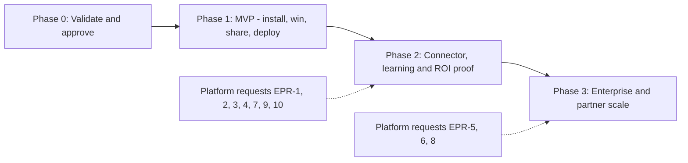

# Implementation Plan: Consulting Firm GTM

## Executive Summary

The plan has four phases. Phase 0 checks the problem with real firms and gets
approval. Phase 1 (MVP) lets a consultant install, get a first win, share it,
build a prototype and deploy it for a client, with no new EAI Platform work.
Phase 2 adds the Gofer connector, training and ROI proof. Phase 3 adds
enterprise sign-in and the partner programme. This plan proposes the work. It
does not report delivered work.

## Phases

### Phase 0: Validate And Approve

| Work                                                                                                 | Owner               | Output                              |
| ---------------------------------------------------------------------------------------------------- | ------------------- | ----------------------------------- |
| Interview 12 firms, four in each segment, about the problem, LinkedIn habits and willingness to pay. | EAI Growth          | Interview synthesis                 |
| Confirm the plugin deep link form and the Claude plans that support plugins (Q1, Q4).                | EAI Growth          | Updated research                    |
| Merge PR #441, which adds `/eai` routing and the consulting playbooks (FR-05).                       | EAI Engineering     | Merged playbooks                    |
| Approve the MVP scope, business model and decisions D1 to D8.                                        | EAI Product and CEO | Dated approval in the specification |
| Set targets for SC-01 to SC-05 and name owners for LinkedIn and partners.                            | EAI Product and CEO | Targets in the specification        |

**Gate:** Phase 1 starts only after the dated Product and CEO approval.

### Phase 1: MVP - Install, First Win, Share, Deploy

No new EAI Platform work is needed. Each workstream can run in parallel unless
the dependency column says otherwise.

| ID  | Workstream                                                                                                                 | Requirements                                    | Owner      | Depends on          |
| --- | -------------------------------------------------------------------------------------------------------------------------- | ----------------------------------------------- | ---------- | ------------------- |
| W1  | Directory listing and landing page with referral codes and the data-handling summary                                       | FR-01, FR-02 (visits), FR-03, FR-43             | EAI Growth | Phase 0             |
| W2  | First run and industry packs                                                                                               | FR-04, FR-07                                    | Gofer team | Phase 0             |
| W3  | New playbooks: AI opportunity scan, ROI one-page summary, share post with post check, personal data warning                | FR-08, FR-09, FR-10, FR-12, FR-13, FR-34, FR-37 | Gofer team | W2 for packs        |
| W4  | Advice to app: ROI baseline into the spec, Code tab guide, intake and triage template, local prototype, demo pack          | FR-14, FR-15, FR-16 (intake), FR-17, FR-18      | Gofer team | W3 for the ROI case |
| W5  | Account and deploy: readiness check, website sign-up guide, client workspaces, access, recovery, deploy, adoption material | FR-19, FR-20, FR-22, FR-23, FR-24, FR-29, FR-33 | Gofer team | None                |
| W6  | Measurement from the directory report, landing page and platform counts                                                    | FR-44                                           | EAI Growth | W1                  |
| W7  | Firm branding of deliverables                                                                                              | FR-11                                           | Gofer team | None                |

**Exit check:**

- The P1 stories in the [specification](spec.md#user-scenarios-and-testing) pass
  their acceptance checks.
- The post check passes all test cases. SC-06 is zero.
- A test firm deploys two client apps. Neither client can see the other's data.
  SC-07 is zero.
- Gofer's own test suite passes.

### Phase 2: Connector, Learning And ROI Proof

| ID  | Workstream                                                                        | Requirements                                     | Owner                              | Depends on         |
| --- | --------------------------------------------------------------------------------- | ------------------------------------------------ | ---------------------------------- | ------------------ |
| W8  | Gofer connector with method, event, referral and training tools                   | FR-02 (installs), FR-06                          | Gofer team                         | EPR-4 for sign-in  |
| W9  | More app templates for common process improvements                                | FR-16 (others)                                   | Gofer team                         | Phase 1            |
| W10 | Training at the right step, on desktop and phone; learning levels and badge posts | FR-25, FR-26, FR-27, FR-28                       | EAI Partner Success and Gofer team | EPR-7              |
| W11 | ROI measures in apps and the realised ROI report; handover                        | FR-31, FR-32                                     | Gofer team                         | Phase 1 deploy     |
| W12 | Firm rollout and firm view                                                        | FR-38, FR-41                                     | Gofer team                         | W8                 |
| W13 | Platform requests                                                                 | EPR-1, EPR-2, EPR-3, EPR-4, EPR-7, EPR-9, EPR-10 | EAI Platform team                  | Platform team plan |

**Exit check:** BS-32 to BS-35, BS-38, BS-40, BS-46 and BS-50 pass.

### Phase 3: Enterprise And Partner Scale

| ID  | Workstream                                           | Requirements        | Owner                              | Depends on              |
| --- | ---------------------------------------------------- | ------------------- | ---------------------------------- | ----------------------- |
| W14 | Enterprise Managed Auth and the Admin Portal setting | FR-39, FR-40        | EAI Platform team and Gofer team   | EPR-5, EPR-6, Q3        |
| W15 | Return from sign-up to Claude                        | FR-21               | Gofer team                         | EPR-1                   |
| W16 | Run cost in the ROI model                            | FR-30               | Gofer team                         | Approved prices (Q5)    |
| W17 | Referral rewards and the partner directory           | FR-35, FR-36        | EAI Growth and EAI Partner Success | Approved programme (Q6) |
| W18 | Private firm method library                          | FR-42               | Gofer team                         | W8                      |
| W19 | Platform requests                                    | EPR-5, EPR-6, EPR-8 | EAI Platform team                  | Platform team plan      |

**Exit check:** BS-26, BS-37, BS-44, BS-45, BS-47 and BS-49 pass.

## Owners

| Role                | Owns                                                             |
| ------------------- | ---------------------------------------------------------------- |
| EAI Product         | Scope, approvals, prices, targets                                |
| EAI Growth          | Landing page, directory listing, LinkedIn programme, measurement |
| Gofer team          | Plugin, playbooks, industry packs, connector, guides             |
| EAI Platform team   | All EAI Platform requests                                        |
| EAI Partner Success | Training, levels, certification, partner directory               |

## Validation Plan

1. **Problem check (Phase 0).** Twelve interviews across S1, S2 and S3. Pass if
   most firms confirm that clients ask for AI advice and that the firm cannot
   build apps today.
2. **First win check (Phase 1).** Ten consultants install from a test post. Pass
   if most finish a first output in their first session.
3. **Build check (Phase 1).** Five consultants build a prototype in the Code tab
   with no help. Record each point where they stop.
4. **Deploy check (Phase 1).** Three firms sign up and deploy a client app.
   Record the time from sign-up start to a live app.
5. **Loop check (Phase 1).** Count posts per active user and visits per post for
   eight weeks.
6. **ROI check (Phase 2).** Two live apps produce a realised ROI report after 90
   days.

The owners replace "most" with numeric targets at the Phase 0 gate.

## Risks

| Risk                                                | Effect                           | Response                                                                             |
| --------------------------------------------------- | -------------------------------- | ------------------------------------------------------------------------------------ |
| The directory review rejects or delays the listing. | No one-click install.            | Keep the landing page install steps for manual install. Start the review in Phase 0. |
| Few people share.                                   | The loop does not grow.          | Test post wording and the badge in the loop check. Add rewards only after approval.  |
| A post exposes client information.                  | Client trust and legal risk.     | The post check, the person's review and test cases with zero tolerance.              |
| People stop at sign-up.                             | Few apps go live.                | The sign-up guide, the two-minute video and EPR-1. Measure drop-off.                 |
| ROI claims are too high.                            | The firm loses credibility.      | Labelled assumptions, low and high cases and realised ROI reports.                   |
| EAI run cost is too high for small clients.         | Weak ROI for S1 clients.         | Price decision at Phase 0 with the ROI model.                                        |
| EMA cannot use the current EAI sign-in service.     | The enterprise path waits.       | Answer Q3 early. Plan a token service if needed.                                     |
| Claude product surfaces change.                     | Guides and screenshots go stale. | Check guides against Claude Desktop each Gofer release.                              |

## Rollback

- **Phase 1.** Remove the new playbooks or the share step in a Gofer release.
  The existing consulting playbooks and the app pipeline keep working.
- **Phase 2.** Turn off the connector. The playbooks still work offline
  (NFR-08).
- **Phase 3.** Turn EMA off per firm in the Admin Portal. Staff use personal EAI
  sign-in.

## Next Step

After approval, Gofer writes `tasks.md` for Phase 1 with dependency-ordered
tasks for W1 to W7.
